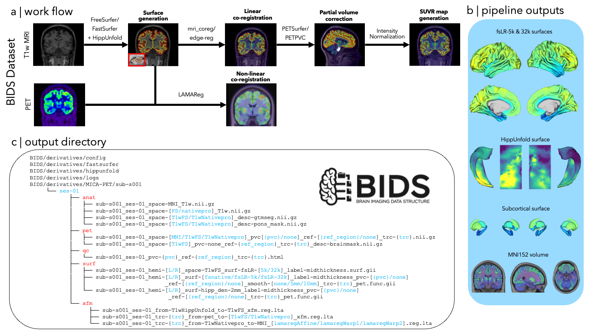

# MICA-PET Pipeline

[](https://hub.docker.com/r/micalab/micapet)
<!-- Uncomment when repository is Public
[](https://github.com/MICA-MNI/micapet)
[](https://www.gnu.org/licenses/gpl-3.0)
[](https://github.com/MICA-MNI/MICA-7t/issues)
[](https://github.com/MICA-MNI/micapet/stargazers)
-->

MICA-PET is a [snakemake](https://snakemake.readthedocs.io/en/stable/)/[snakebids](https://github.com/khanlab/snakebids) neuroimaging workflow for processing static PET data in a [BIDS](https://bids.neuroimaging.io/)-compatible project. It runs anatomical reconstruction, PET-to-MRI registration, partial volume correction, surface projection, and report generation from a single entry point.



## What this repository contains

- [run.py](run.py): main command-line entry point
- [workflow](workflow): Snakemake workflow definition
- [functions](functions): processing steps for anatomy, coregistration, PVC, SUVR, and QC
- [resources](resources): supporting files and templates
<!-- - [scripts](scripts): helper scripts for Singularity and cluster submission -->

## Requirements

Before installing the pipeline, make sure you have:
- A valid [FreeSurfer license file](https://surfer.nmr.mgh.harvard.edu/registration.html)
- [FreeSurfer](https://surfer.nmr.mgh.harvard.edu/fswiki/rel6downloads) installed (tested with v6.0)
  
### If running from a Conda environment: 
- Conda
- Apptainer/Singularity installed on the host (if running Singularity version of MICA-PET or running FastSurfer and/or HippUnfold as part of the MICA-PET pipeline)
- [Connectome Workbench](https://www.humanconnectome.org/software/workbench-command) installed locally (tested with v2.2.1)

### If running from the Apptainer/Singularity container:
- Apptainer/Singularity
  
### Optional if FastSurfer and/or HippUnfold need to be run via the MICA-PET pipeline:
- Singularity container images of [FastSurfer](https://github.com/Deep-MI/FastSurfer/releases/tag/v2.4.2) (tested with v2.4.2) 
- [HippUnfold](https://hippunfold.khanlab.ca/en/latest/index.html) (tested with v1.4.1)
- Not necessary if FastSurfer/FreeSurfer/HippUnfold already run or if HippUnfold outputs are not necessary

## Installation

### Option #1: Conda environment
```bash
git clone <repo-url>
cd micapet
conda env create -f environment.yml
conda activate mica-pet
chmod +x run.py
```

- For nonlinear co-registration to MNI152, please also download the [LAMAReg](https://github.com/MICA-MNI/LAMAReg) model weights into the [resources subdirectory](resources)

### Option #2: Apptainer/Singularity container
MICA-PET may also be run from an Apptainer/Singularity format (.sif) for use in HPC environments.

```bash
# Either build singularity image from Docker Hub
singularity build micapet.sif docker://jacx11/micapet:v.beta.0.1

# Or build singularity image locally
export DOCKER_BUILDKIT=1
export DOCKER_CONTENT_TRUST=0
export SINGULARITY_TMPDIR=/path/to/tmpdir
export SINGULARITY_CACHEDIR=/path/to/cachedir

cd micapet
docker build -t micapet:v.beta.0.1 .
singularity build micapet.sif docker-daemon://micapet:v.beta.0.1
```

<!--### Docker
The latest Docker image can be pulled from Docker Hub

```bash
docker pull micalab/micapet:v.alpha.0.1

docker run --rm -v _____
```
-->

## Inputs

- 3D T1w MRI (sub-\<subject>_ses-\<session>_T1w.nii.gz)
- static (3D) PET (sub-\<subject>_ses-\<session>_trc-\<trc>_pet.nii.gz)

## Quick start

Before running the pipeline, ensure you have created your BIDS directory in the configuration below, using the exact same nomenclature for the raw data:

```text
BIDS
├── rawdata/
|   └── sub-<subject>
|       └── ses-<session>
|           ├── anat
|           |   ├── sub-<subject>_ses-<session>_T1w.json
|           |   └── sub-<subject>_ses-<session>_T1w.nii.gz
|           └── pet
|               ├── sub-<subject>_ses-<session>_trc-<trc>_pet.json
|               └── sub-<subject>_ses-<session>_trc-<trc>_pet.nii.gz
└── derivatives
    ├── config/                          # will be automatically generated by snakemake
    ├── fastsurfer
    |   └── sub-<subject>_ses-<session>/ # add pre-run FreeSurfer/FastSurfer subject output here if available
    ├── hippunfold_v1.4.1
    |   └── hippunfold
    |       └── sub-<subject>
    |           └──_ses-<session>/       # add pre-run HippUnfold subject output here if available
    ├── logs/                            # will be automatically generated by snakemake
    └── MICA-PET_v.beta.0.1              # will be automatically generated by snakemake
        └── sub-<subject>               
            └──_ses-<session>/           
```

### Option #1: Conda environment

Run the workflow for one participant with:

```bash
./run.py \
  --fastsurfer-img /path/to/fastsurfer.sif \
  --hippunfold-img /path/to/hippunfold.sif \
  --fs-license /path/to/license.txt \
  --psf {psf} \
  --ref_region {reference region} \
  --smoothing {FWHM} \
  --pvc_method {PVC method} \
  {other parameters here} \
  /path/to/bids /path/to/bids/derivatives participant \
  --cores {# of cores or 'all'} \
  --participant-label {participant ID} \
  {snakemake options}
```

### Option #2: Apptainer/Singularity container

Or via the container:
```bash
# Run MICA-PET pipeline
singularity run --cleanenv --env FS_LICENSE="/path/to/license.txt" \
-B ${BIDS_DIR}:/bids -B /path/to/LOCAL_FREESURFER_HOME:/micapet/freesurfer \
/path/to/micapet.sif \
--fastsurfer_img /path/to/fastsurfer-cpu-v2.4.2.sif \
--hippunfold_img /path/to/hippunfold_v1.4.1.sif \
--fs_license /path/to/license.txt \
--psf ${psf} \
--ref_region ${ref_region} \
--smoothing 5 10 \
--pvc-method ${pvc_method} \
--existing-freesurfer-dir /path/to/existing/fastsurfer \
--existing-hippunfold-dir /path/to/existing/hippunfold_v1.4.1 \
--nonlinear-coreg \
/bids /bids/derivatives participant \
--cores ${CORES} \
--participant-label ${subject} \
{snakemake options}
```


### Mandatory parameters

- `--psf`: full-width half-max of the scanner point spread function (PSF) in mm. Consult your PET physicist if unsure. For more information, see [here](https://surfer.nmr.mgh.harvard.edu/fswiki/PetSurfer)
- `--ref-region`: SUVR reference region (`pons`, `cerebellarGM`, `cerebellum`, `composite`, `WM` (supratentorial white matter), or `GM` (whole brain cortex)). Alternatively, add a custom reference region by adding it to resources/ref_region_list.csv (ref_region = reference region name, ROI = ROI label # according to gtmseg.mgz, erode = TRUE/FALSE per ROI if you want to erode that label by 2 voxels)
- `--pvc-method`: FreeSurfer PETSurfer methods such as: `RBV-FS`, `MG-FS`, or PETPVC methods such as: `MG`, `IY`, `LABBE`, `RL`, `VC`, `RBV`, `LABBE+RBV`, `RBV+VC`, `RBV+RL`, `LABBE+RBV+VC`, `LABBE+RBV+RL`, `MTC`, `LABBE+MTC`, `MTC+VC`, `MTC+RL`, `LABBE+MTC+VC`, `LABBE+MTC+RL`, `IY+VC`, `IY+RL`, `MG+VC`, `MG+RL`.
- `--fs-license`: path to the FreeSurfer license file, which can be obtained [here](https://surfer.nmr.mgh.harvard.edu/registration.html)
- `--fastsurfer-img`: (if FastSurfer to be run) path to the FastSurfer Singularity image
- `--hippunfold-img`: (if HippUnfold to be run) path to the HippUnfold Singularity image
- `--existing-freesurfer-dir` : (if FastSurfer/FreeSurfer already run) Path to existing FreeSurfer subject outputs directory (ex. /path/to/freesurfer/sub-01_ses-01). If provided, will create symlinks instead of running FastSurfer.
- `--existing-hippunfold-dir` : (if HippUnfold already run) Path to existing HippUnfold subject outputs directory (ex. /path/to/hippunfold_v1.4.1). If provided, will create symlinks instead of running HippUnfold.

### Optional parameters
- `--hippunfold-cache-dir` : Path to hippunfold cache directory.
- `--skip-hippunfold` : Flag to skip HippUnfold processing. If set, will not run HippUnfold and will not require HippUnfold outputs.
- `--edge-reg`       : Flag to use edge-based registration method for PET to T1w registration rather than FreeSurfer mri_coreg.
- `--nonlinear-coreg` : Flag to perform nonlinear co-registration to MNI space. If set, will run lamareg nonlinear registration.
- `--smoothing`: one or more smoothing values for cortical surface projection
- `--threads`: number of CPU threads
- `--normalize-histogram-max`: Flag to normalize surface map by the histogram maximum prior to Z-score calculation

### Optional PETPVC parameters
- `--pvc_mask`       : Optional custom mask to use for PETPVC. Must be a 4D NIfTI with one ROI per frame. Sum across timeframes must be 1 at each voxel. Must be in FreeSurfer/FastSurfer space (eg. orig.mgz). If not provided, a two tissue mask will be generated for MG PVC and a GM+WM+CSF+background mask will be generated for all others.
- `--pvc-iterations` : Number of iterations for iterative PVC methods (default 50).
- `--pvc-n_iter`     : Number of iterations for iterative PVC methods (IY) (default: 10).
- `--pvc-n_deconv`   : Number of iterations for deconvolution PVC methods (RL, VC) (default: 10).

### Snakemake options
- `--force <rule>`    : Reruns only the specified rule. See workflow/rules/all.smk for rules
- `--forcerun <rule>` : Reruns the specified rule and updates everything downstream
- `--forceall`        : Forces the execution of every single rule in the entire workflow
- `--rerun-incomplete`: Re-runs all tasks that failed or left partial files
- `--unlock`          : If your process crashed hard, you might also have a directory lock error. Clear it using the --unlock flag before running the pipeline again

<!-- -->

## Typical outputs

The pipeline writes derivatives into the output directory, including:

- reference region masks
- partial volume corrected and normalized PET images
- registration transforms
- fsLR 32k & 5k surface metrics in GIFTI format
- QC report images and HTML report

## Repository layout

```text
.
├── config/
|   └── snakebids.yml
├── functions/
|   ├── MICA_PET.py
|   └── utils.py
├── resources/
|   ├── AFNI/
|   |   └── 3dresample
|   ├── lamareg/
|   |   ├── synthseg_parc_2.0.h5
|   |   ├── synthseg_robust_2.0.h5
|   |   ├── synthseg_robust_2.0.h5.000
|   |   ├── synthseg_robust_2.0.h5.001
|   |   └── synthseg_robust_2.0.h5.002
|   ├── mni_icbm152_t1_tal_nlin_sym_09a_parc.nii.gz
|   └── mni_icbm152_t1_tal_nlin_sym_09a.nii.gz
├── workflow/
|   ├── rules
|   |   └── all.smk
|   └── Snakefile
├── README.md
├── run.py
└── environment.yml
```
<!-- | | └── 3dresample

| | ├── synthseg_parc_2.0.h5
| | ├── synthseg_robust_2.0.h5
| | ├── synthseg_robust_2.0.h5.000
| | ├── synthseg_robust_2.0.h5.001
| | └── synthseg_robust_2.0.h5.002 -->

<!-- ## HPC usage

For cluster execution, the repository includes helper scripts under [scripts](scripts) for submitting jobs to PBS/Torque-style systems. For multi-subject runs, it is recommended to use a separate output directory per participant to avoid workflow configuration conflicts. -->

## Troubleshooting

- If the workflow fails with a config error, rerun with a per-subject output directory.
- If a previous job was interrupted, rerun with `--unlock` or clean the stale lock and then run it again.
- If FreeSurfer steps fail, verify that the license path and container bindings are correct.
- If you want to reuse prior outputs, pass the existing directory flags to skip expensive reruns.

## Notes

This repository is intended for research use and assumes a working neuroimaging software stack and container environment.
